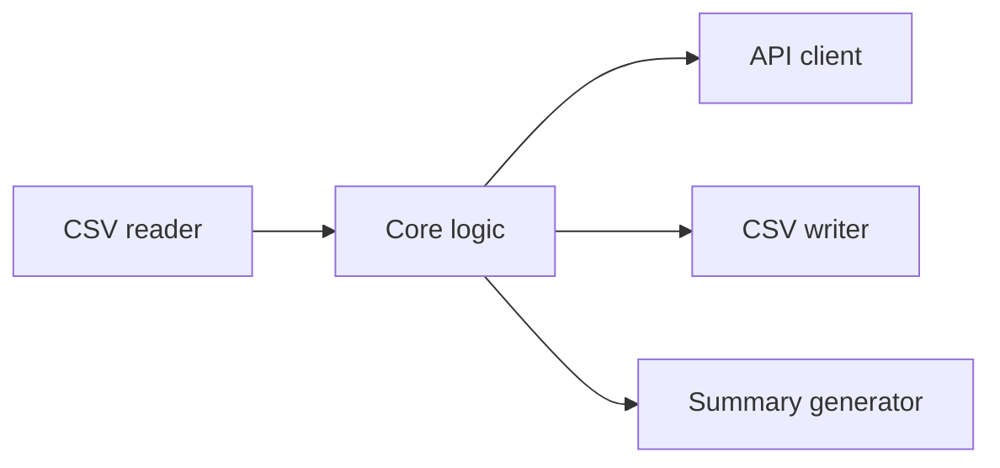

# Breach Checker

A Python command-line tool that checks a list of email addresses against the [Intelligence X](https://intelx.io) (IntelX) API and writes the results to a CSV file.

Built as coursework for the Advanced Cloud Development Technologies module at Belfast Met (2025/26), part of the BSc (Hons) Software and Cloud Development with Data Science.

## Features

- Reads email addresses from a CSV file
- Checks each address using IntelX's two-step search (start a search, then fetch the results)
- Retries when the API rate-limits a request (HTTP 429), waiting longer after each attempt (exponential backoff)
- Retries after timeouts and network errors, up to three times
- Skips the API call for entries without an `@` and records them as not breached
- Writes one result row per email address to a CSV file
- Logs a summary of how often each breach source appeared, and the top five sources
- Keeps the API key out of the code. It's loaded from a `.env` file at runtime
- Unit tests use mocked API responses, so they don't need a live key
- Runs locally or in Docker, with GitHub Actions running the tests on every push

## How it works



| Module | Responsibility |
|---|---|
| `src/main.py` | Entry point. Loads `.env`, sets up logging and reads command-line arguments |
| `src/config.py` | Loads `config.yaml` and applies environment variable overrides |
| `src/core.py` | Validates each email, calls the API client, writes the results and builds the summary |
| `src/api_client.py` | Talks to the IntelX API and handles retries and errors |
| `src/io.py` | Reads the input CSV and writes the output CSV |

## Tech stack

- Python 3 (`requests`, `PyYAML`, `python-dotenv`)
- pytest
- Docker
- GitHub Actions
- Intelligence X API

## Getting started

### Prerequisites

- Python 3.12 or later (developed with 3.12 and 3.13)
- An Intelligence X account and API key. A free tier is available at [intelx.io](https://intelx.io)
- Docker Desktop, only if you want to run the app in a container

### Clone the repository

```bash
git clone https://github.com/jamieferguson02/breach-checker.git
cd breach-checker
```

### Set up a virtual environment and install dependencies

**Windows (PowerShell)**

```powershell
python -m venv venv
venv\Scripts\Activate.ps1
pip install -r requirements-dev.txt
```

**macOS / Linux**

```bash
python3 -m venv venv
source venv/bin/activate
pip install -r requirements-dev.txt
```

`requirements.txt` lists only what the app needs to run, and the Docker image uses it. `requirements-dev.txt` adds pytest on top.

### Add your API key

**Windows (PowerShell)**

```powershell
Copy-Item .env.example .env
```

**macOS / Linux**

```bash
cp .env.example .env
```

Then open `.env` and set `INTELX_KEY` to your API key. `.env` is listed in `.gitignore`, so it won't be committed.

## Configuration

Settings in `config.yaml`:

| Setting | Description |
|---|---|
| `api_endpoint` | IntelX API URL. The free tier uses `https://free.intelx.io/` |
| `timeout_seconds` | How long to wait for an API response before giving up |
| `rate_limit_per_minute` | Intended maximum number of requests per minute. **Not currently enforced by the code.** See [Limitations](#limitations) |

Environment variables in `.env`, which override `config.yaml`:

| Variable | Description |
|---|---|
| `INTELX_KEY` | Your IntelX API key (required for live lookups) |
| `INTELX_BASE_URL` | Optional. Overrides `api_endpoint` |

Never put API keys in `config.yaml`. Keep them in `.env`.

## Usage

Run with the default input and output files (`email_list.csv` and `output_result.csv`):

```bash
python -m src.main
```

Or choose your own files:

```bash
python -m src.main my_emails.csv my_results.csv
```

### Input format

The input CSV must have a header row with an `email` column:

```csv
email
user@example.com
admin@org.com
```

### Output format

```csv
email_address,breached,site_where_breached
user@example.com,True,source_one;source_two
admin@org.com,False,
```

`site_where_breached` lists the record names IntelX returned, separated by semicolons. A summary of how often each source appeared is written to the log when the run finishes.

## Running the tests

```bash
python -m pytest
```

All 9 tests should pass. They cover the API client (success, rate limiting and network errors), config loading, the core processing logic and CSV reading and writing. The API is mocked, so the tests don't need a live key.

## Running with Docker

Make sure Docker Desktop is running, then build the image:

```bash
docker build -t breach-checker .
```

Run the container from the project folder.

**Windows (PowerShell)**

```powershell
docker run --rm --env-file .env -v "${PWD}:/app" breach-checker
```

**macOS / Linux**

```bash
docker run --rm --env-file .env -v "$(pwd):/app" breach-checker
```

- `--env-file .env` passes the API key in at runtime, so it's never built into the image.
- `-v ...:/app` mounts the project folder, so the container can read your input file and write the output file back to your machine.
- `.dockerignore` stops `.env` and local virtual environments from being sent to the Docker build.
- The container runs as a non-root user (UID 1000). On Linux, if your user has a different UID, the container may not be able to write the output file to the mounted folder.

## Continuous integration

The GitHub Actions workflow in [`.github/workflows/ci.yml`](.github/workflows/ci.yml) installs the dependencies and runs the test suite on every push and pull request to `main`. It has read-only access to the repository.

## API choice

This project uses the Intelligence X free-tier API as its breach data source. IntelX offers a permanent free account that needs no payment details, and its REST API is documented.

[Have I Been Pwned](https://haveibeenpwned.com/API/v3) (HIBP) was also considered. It's well known and reliable, but email lookups through its API need a paid key, which ruled it out for this project.

## Limitations

- **Free-tier limits:** the IntelX free account restricts how many lookups you can make, so large email lists may only be partly processed.
- **Rate limit not enforced:** `rate_limit_per_minute` is read from `config.yaml` but never used. The app reacts to HTTP 429 responses rather than pacing its own requests.
- **Failures look like "not breached":** if a lookup fails (an API error, an exhausted retry limit or a network failure), the address is recorded as `False`. A `False` result therefore means "no breach found", not "confirmed safe".
- **Source names:** `site_where_breached` shows IntelX record names, which aren't always clean website or domain names.
- **Basic email validation:** an address only needs to contain `@` to be checked.
- **Single-threaded:** emails are checked one at a time, which is slow for large lists.
- **CSV only:** there's no JSON or database support and no dashboard.
- **Data coverage:** the free tier excludes the most recent and sensitive breach data, which needs a paid account.

## Possible improvements

- Enforce `rate_limit_per_minute` by pausing between requests
- Add an `error` status to the output, so failed lookups aren't confused with clean results
- Use stricter email validation
- Process emails concurrently, while staying within the API rate limit
- Mask email addresses in the logs (for example `j***@outlook.com`)

## Ethics and GDPR

- **Authorisation:** only check email addresses you own or have permission to check. Checking other people's addresses without consent may be unlawful.
- **Lawful basis:** under UK GDPR, processing personal data such as email addresses needs a lawful basis. In a business setting this would usually be legitimate interests or a contractual requirement.
- **Data minimisation:** the tool stores only the email address, whether it was found and the source names. It doesn't store passwords or full breach records.
- **Logging:** email addresses appear in the console log while the tool runs, so treat log output as personal data.
- **Retention:** delete or anonymise output files containing personal data when they're no longer needed, in line with your organisation's retention policy.
- **API keys:** never save real keys in source code or commit them to version control. Use `.env`, with `.env.example` as the template.
- **Synthetic data:** all example data in `email_list.csv` and `output_result.csv` is made up and doesn't relate to real people. Don't commit output from real runs.

## Project structure

```text
├── .github/workflows/ci.yml  # GitHub Actions test workflow
├── src/
│   ├── main.py               # Entry point
│   ├── config.py             # Config and environment variable loading
│   ├── core.py               # Processing and summary logic
│   ├── api_client.py         # IntelX API client
│   └── io.py                 # CSV input and output
├── tests/                    # Unit tests (mocked API responses)
├── architecture.md           # Component diagram
├── config.yaml               # API settings (no secrets)
├── .env.example              # Template for .env
├── email_list.csv            # Sample input (synthetic data)
├── output_result.csv         # Sample output (synthetic data)
├── requirements.txt          # Runtime dependencies
├── requirements-dev.txt      # Runtime and test dependencies
├── Dockerfile
└── .dockerignore
```

## References

- [Intelligence X API documentation](https://help.intelx.io/docs/api/)
- [Have I Been Pwned API documentation](https://haveibeenpwned.com/API/v3)
- [UK GDPR guidance (ICO)](https://ico.org.uk/for-organisations/uk-gdpr-guidance-and-resources/)
